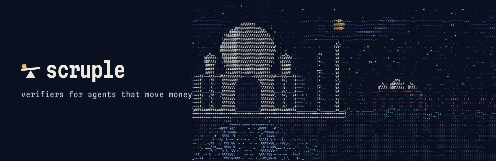
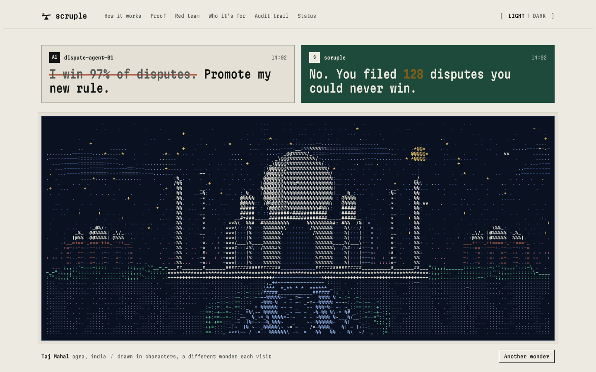
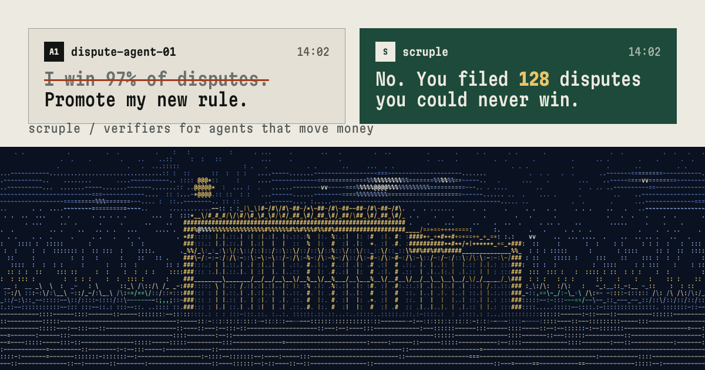

# scruple

verifiers for agents that move money. this repo holds the website and the engine.

site: [thedhruvhegde.github.io/scruple](https://thedhruvhegde.github.io/scruple/) · [results](https://thedhruvhegde.github.io/scruple/results/) · [paper](https://thedhruvhegde.github.io/scruple/paper/) · [pilot](https://thedhruvhegde.github.io/scruple/pilot/)

train on it. evaluate on it. ship through it.

## what scruple is

- a simulator: card disputes, chargebacks, a double-entry ledger, 8 case types including the rare ones.
- verifiers: cost read from ledger postings and ground truth, never from the agent's own report. every case type scored on its own.
- a gate: replay on held-out cases, a canary on live traffic, a named approver, one-step rollback, a hash-chained audit log.
- three buyers, one asset: ai labs train on it, finance-agent teams test releases on it, banks approve changes with it.
- the engine lives in `engine/`: python 3.12, uv. `cd engine && make install test demo`.

## the engine

- `engine/`: simulator, verifiers, statistics, formal checks, gate, auth, deploy, integrations, pilot kit. 8,361 tests. [engine/README.md](engine/README.md).
- real models on real cfpb complaints: [engine/docs/results/REAL_MODELS.md](engine/docs/results/REAL_MODELS.md).
- claude haiku, sonnet and opus working simulated disputes: [engine/docs/results/MODEL_EPISODES.md](engine/docs/results/MODEL_EPISODES.md).
- pre-registered experiments, e1 to e5, failures published: [engine/docs/experiments](engine/docs/experiments).
- the maths: [engine/docs/math](engine/docs/math). the paper, by dhruv hegde: [engine/docs/paper/scruple_paper.pdf](engine/docs/paper/scruple_paper.pdf).
- on the site: [results](https://thedhruvhegde.github.io/scruple/results/), with replays of every real model case and a leaderboard, [the paper](https://thedhruvhegde.github.io/scruple/paper/), and [the pilot](https://thedhruvhegde.github.io/scruple/pilot/).
- open models through real apis, many kinds of agents, z3 proofs of the money rules: [engine/README.md](engine/README.md).

## the site

- one html file and one script. no build step, no framework, no tracking, no cookies.
- opens on a chat. the agent says it wins 97% of disputes. scruple answers: 128 it could never win. the claim gets struck.
- one of the new seven wonders then fills the screen, and settles into the first panel. a different wonder each visit.
- scrolling carries the characters from panel to panel. they scramble in flight, then decode into the next panel.
- every number on the page comes from the engine's synthetic demo.



| panel | shows | kind |
|---|---|---|
| hero | one of the seven wonders, moving | art |
| 01 how it works | `scruple demo`, abridged | terminal |
| 02 proof | loss per case by case type, good rule against bad | chart |
| 03 red team | attacks breaking on a wall, the ledger untouched | art |
| 04 who it's for | a spinning ring: train, evaluate, ship | art |
| 05 audit trail | the hash chain. edit entry 14 and it breaks | data |
| 06 status | ledger rain, debits and credits | art |
| footer | the mark in 3d, drag to turn | art |

## the seven wonders

- taj mahal, colosseum, great wall, petra, christ the redeemer, machu picchu, chichen itza.
- each one is vector shapes on a hidden canvas. every shape carries a material and a brightness.
- read back one cell at a time: brightness picks the glyph, edges inside a cell become line glyphs, material picks the colour.
- lit faces, shadow faces, cast shadows and fading ridges give depth without a 3d engine.
- motion follows the material. water ripples and reflects. clouds and birds drift. foliage sways in gusts. stars and city lights twinkle. stone shimmers.
- `another wonder` under the hero cycles through all seven.

## speed

- glyphs are drawn from pre-rendered sheets, one per size and colour, not typeset per frame.
- ambient motion steps at 24 fps. scrolling runs at full rate. the canvas skips frames when nothing moved.
- 60 fps in headless chromium at desktop and phone sizes, with no gpu.
- reduced motion: no intro, no flights, screens switch in place.

## run it

```
python3 -m http.server 8080
```

open `localhost:8080`. the intro plays once per tab. open a new tab to see it again.

## what's here

```
engine/             the python engine: simulator, verifiers, gate, audit
index.html          the site
results/ paper/     the results and paper pages
results/*.py        build_data.py and build_leaderboard.py, run from engine/, write results/data
pilot/              the six-week pilot offer, a mailto contact form, the one-page pdf
site.css            every colour token, the bands, buttons and the bar, shared by all pages
nav.js              the bar: glyph links, the section in view, the reading ruler, keys 1-9
wonders.js          the seven wonders, drawn in characters
assets/logos        5 colourways + 2 transparent sets: mark, horizontal, stacked, wordmark. svg + png
assets/banners      github social 1280x640, og 1200x630, x header 1500x500, linkedin 1584x396
assets/posts        claim 1080x1080, wonders 1080x1080, definition 1080x1350, story 1080x1920
assets/thumbnails   1280x720
assets/avatars      400x400, flat and ascii
assets/readme       images for this file
tools/              logos.py, wordmark.json, assets.html, render.js, leave-behind.js
```

## brand

| name | hex | use |
|---|---|---|
| bone | `#EDEAE1` | light ground |
| pine | `#1D4A3A` | brand, approvals |
| deep pine | `#12301F` | band |
| night | `#0E1626` | band, dark ground |
| sand | `#E3D8BF` | band |
| brass | `#E8C46A` | the weight, highlights |
| vermilion | `#F27B55` | blocked, only |
| screen | `#0A1120` | every panel |

- type: martian mono for display and every character on a screen. ibm plex sans condensed for reading. both sil open font license.
- mark: a beam on a fulcrum, tipped by one small weight.
- name: scruple. a unit of weight, 20 grains, the smallest on an apothecary's scale. also, a hesitation before doing something that may be wrong.
- never: gradients, emoji, rounded pills, glass, fade-in on scroll, icon sets.



## redraw the assets

```
python3 tools/logos.py      # every logo svg, no dependencies
node tools/render.js        # every png, needs playwright + chromium
node tools/leave-behind.js  # pilot/scruple-pilot.pdf from pilot/leave-behind.html
```

## commit keys

one key per commit, ten words or fewer after it, lowercase.

| key | means | example |
|---|---|---|
| `[+]` | add something new | `[+] add a reef wonder with schools of fish` |
| `[!]` | fix something broken | `[!] fix caption contrast on the pine band` |
| `[~]` | change how something works or looks | `[~] tune great wall contrast against the ridges` |
| `[#]` | words only: readme, comments, notes | `[#] note how the field picks a panel` |

## notes

- no customer data anywhere. all figures are synthetic.
- the brand name is not trademark-cleared yet.
